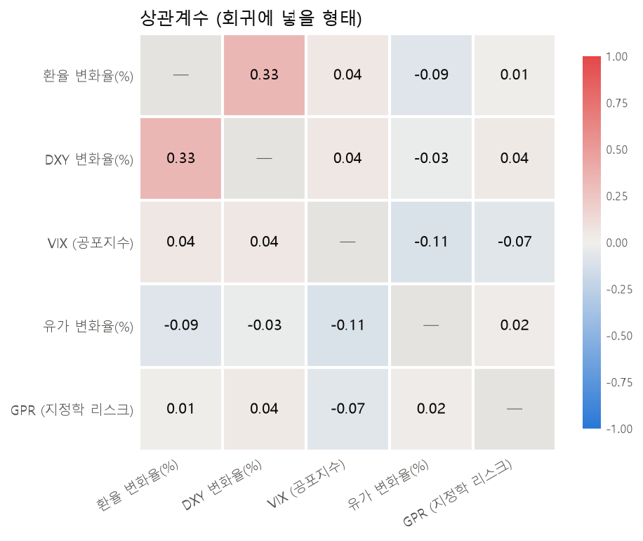
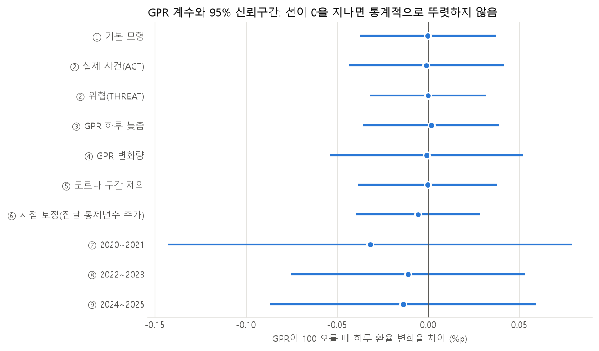
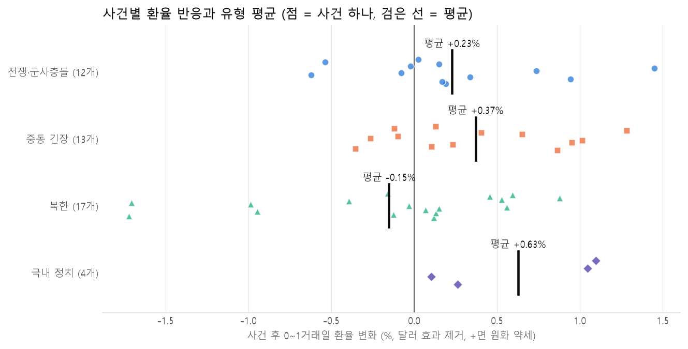

# 지정학적 리스크(GPR)와 원/달러 환율

> **"전쟁이 나면 환율이 오른다"는 말, 데이터로 확인해 봤습니다.**
> 2020~2025년 일별 데이터에서 지정학적 리스크 지수(GPR)는 평소에도, 큰 사건 직후에도 원/달러 환율과 뚜렷한 관계를 보이지 않았습니다. 환율은 지정학적 리스크보다 달러와 훨씬 강하게 같이 움직였습니다.

교내 AI학회 **매트릭스** 2026년 2학기 미니프로젝트 4팀 *"환율을 움직이는 건 무엇일까? - 환율 영향 지수 분석 및 환율 예측 모델"* 중, **GPR 파트**를 담은 레포입니다.

## 내 역할

| 팀원 | 담당 |
|---|---|
| **이태균** | **조장, GPR(지정학적 리스크) 분석, 발표자료 제작** ← 이 레포 |
| 김지영 | 브렌트 유가 전처리와 상관분석, 데이터 전처리 총괄 |
| 서해성 | VIX 전처리와 상관분석, 발표 준비 |
| 김규한 | 원/달러 환율·달러 인덱스, 예측 모델링과 결론, 발표자료 통합 |

팀 전체 발표자료는 [`docs/4팀_미니프로젝트_발표자료.pdf`](docs/4팀_미니프로젝트_발표자료.pdf)에 있습니다. 이 레포의 코드와 결과는 GPR 파트만 포함합니다.

## 질문

1. 달러, 시장 불안(VIX), 유가를 함께 고려해도 **GPR이 환율 변화를 추가로 설명하는가?**
2. 평소에는 관계가 없더라도, **큰 지정학적 사건 직후에는** 환율이 반응하는가?

## 데이터

| 변수 | 출처 | 역할 |
|---|---|---|
| 원/달러 환율 | FRED `DEXKOUS` (뉴욕 정오 기준) | 결과 |
| 달러 인덱스 | ICE DXY (Yahoo Finance `DX-Y.NYB`) | 통제 |
| VIX | FRED `VIXCLS` | 통제 |
| 브렌트유 | FRED `DCOILBRENTEU` | 통제 |
| **GPR** | [Caldara & Iacoviello, Daily GPR](https://www.matteoiacoviello.com/gpr.htm) | **관심 변수** |

- 기간: 2020-01-01 ~ 2025-12-31, 분석에 쓴 공통 거래일 **1,464일**
- GPR: 주요 신문 10개에서 전쟁·테러·핵 위협 관련 단어가 함께 나온 기사 비율로 만든 텍스트 기반 지수 (1985~2019년 평균 = 100)
- 원자료는 재배포 조건이 출처마다 달라 레포에 넣지 않았습니다. 받는 방법은 [`data/README.md`](data/README.md)를 보세요.

## 방법

### 1. 전처리
- **서로 다른 달력 맞추기:** GPR은 매일 있지만 환율은 미국 거래일에만 있습니다. 주말·공휴일의 GPR을 버리지 않고 **다음 거래일에 평균**으로 넣었습니다.
- **빈 날 처리 후 다시 맞추기:** 한 변수라도 비어 있는 34일을 뺀 뒤, 그 기간의 GPR도 다시 평균했습니다. 이틀치 환율 변화와 하루치 GPR이 짝지어지는 오류를 막기 위해서입니다.
- **정상성 검정(ADF):** 환율·달러·유가는 가격 수준이 비정상이라 **로그 변화율**로 바꿨습니다. VIX와 GPR은 수준값이 정상이었습니다.
- **극단값:** 2020년 4월 유가 -64% 같은 값은 실제 사건이라 삭제하지 않고 표시만 했습니다.

### 2. 상관분석과 회귀분석
- `환율 변화율 = 달러 변화율 + VIX + 유가 변화율 + GPR`
- 표준오차는 **Newey-West(HAC)** 방식으로 계산했습니다. 일별 금융 데이터의 자기상관과 이분산을 반영하기 위해서입니다.
- 강건성 검증 9가지: 실제 사건(ACT)과 위협(THREAT) 분리, GPR 하루 늦추기, GPR 변화량, 코로나 구간 제외, 측정 시점 보정, 기간 3개 분할

### 3. 사건 분석 (이벤트 스터디)
- 국내외 사건 **46개**를 4가지 유형으로 분류했습니다.
- **선택 편향 방지:** 환율 결과를 보기 전에 사건 고르는 규칙을 정했습니다. 처음 고른 19개 + 일별 GPR 상위 30개 급등일의 직전 사건 + 북한 ICBM 발사 전부입니다.
- **달러 효과 제거:** 사건이 없는 날로 환율과 달러의 평소 관계를 추정하고, 사건 후 환율 변화에서 그만큼을 뺐습니다.
- **순열 검정:** 사건이 없는 날을 같은 개수만큼 무작위로 20,000번 뽑아 비교했습니다.
- **다중비교 보정:** 유형 4개를 동시에 검정했으므로 Holm 방식으로 p값을 보정했습니다.

## 결과

### 평소: GPR과 환율은 거의 관계가 없었다

| 환율 하루 변화와의 상관계수 | 값 |
|---|---|
| 달러 | **0.33** |
| 유가 | -0.09 |
| VIX | 0.04 |
| **GPR** | **0.01** |

달러, VIX, 유가를 함께 넣은 회귀분석에서 GPR 계수는 사실상 0이었고(p = 0.989), 강건성 검증 9가지 모두 같은 결과였습니다.




### 큰 사건 직후: 유형 간 차이도 우연 범위였다

| 유형 | 사건 수 | 사건 후 이틀간 환율 변화 (달러 효과 제거) | 보정 p값 |
|---|---|---|---|
| 전쟁·군사충돌 | 12 | +0.23% | 0.355 |
| 중동 긴장 | 13 | +0.37% | 0.099 |
| 북한 | 17 | -0.15% | 0.355 |
| 국내 정치 | 4 | +0.63% | 0.107 |

- 처음 19개 사건에서는 중동 긴장이 **+0.66%**로 의미 있어 보였지만, 규칙에 따라 46개로 늘리자 **+0.37%**로 줄었습니다. 작은 표본에서 효과가 과대평가될 수 있음을 직접 확인했습니다.
- GPR이 크게 뛴 사건일수록 환율이 더 오르지도 않았습니다 (상관계수 -0.02).



### 분석 중 발견한 점: 측정 시점 차이
환율(뉴욕 정오)과 달러(미국 종가)는 같은 날짜여도 측정 시각이 다릅니다. 회귀식에 **전날** 달러 값을 넣으면 설명력이 0.115에서 0.210으로 크게 올랐습니다. 이 시점 차이는 팀 예측 모델의 핵심 한계와도 같은 내용이었습니다.

## 결론과 한계
- 2020~2025년 데이터에서 **"전쟁이 나면 환율이 오른다"는 말은 확인되지 않았습니다.** 팀 예측 모델에 GPR을 추가했을 때도 성능은 좋아지지 않았습니다 (팀원 모델링 결과).
- 관계를 본 것이지 원인을 증명한 것은 아닙니다. 며칠에 걸친 반응은 따로 확인하지 않았습니다.
- GPR은 세계 기준 지수라 한국 고유의 위험(북한, 국내 정치)은 약하게 반영됩니다.
- 기간이 6년이고, 국내 정치 사건은 4개뿐입니다. 사건 분류에는 판단이 들어갔습니다.

## 실행 방법

```bash
pip install -r requirements.txt
# data/README.md를 보고 data/raw/에 원자료를 넣은 뒤, 레포 최상위에서 순서대로 실행
python src/preprocess_gpr.py           # GPR 기간 자르기, 결측·이상치 점검, 주말 처리
python src/merge_preprocess.py         # 5개 변수 합치기, 거래일 정렬, 변화율 변환
python src/stage2_eda.py               # 기술통계, ADF, 상관분석, 그래프
python src/stage3_regression.py        # 회귀분석 (Newey-West), 강건성 검증
python src/stage5_events.py            # 사건 19개 분석 (초기)
python src/stage5b_events_expanded.py  # 사건 46개 분석 (규칙 기반 확장)
python src/stage5c_gpr_week.py         # 사건 후 일주일 비교 (추가 분석)
python src/fig_fx_brent.py             # 환율·유가 비교 그래프
```

그래프의 한글은 Windows의 맑은 고딕 글꼴을 사용합니다.

## 폴더 구조

```
├─ src/              분석 코드
├─ data/
│  ├─ raw/           원자료 (직접 내려받기, 레포에 미포함)
│  └─ processed/     전처리 결과 (코드 실행 시 생성)
├─ output/           그래프(fig*.png)와 결과 표(table*.csv)
└─ docs/             분석 보고서, 팀 발표자료, GPR 파트 발표 대본
```

## 참고 문헌
- Caldara, D. and M. Iacoviello (2022), "Measuring Geopolitical Risk," *American Economic Review*, 112(4), 1194–1225.
